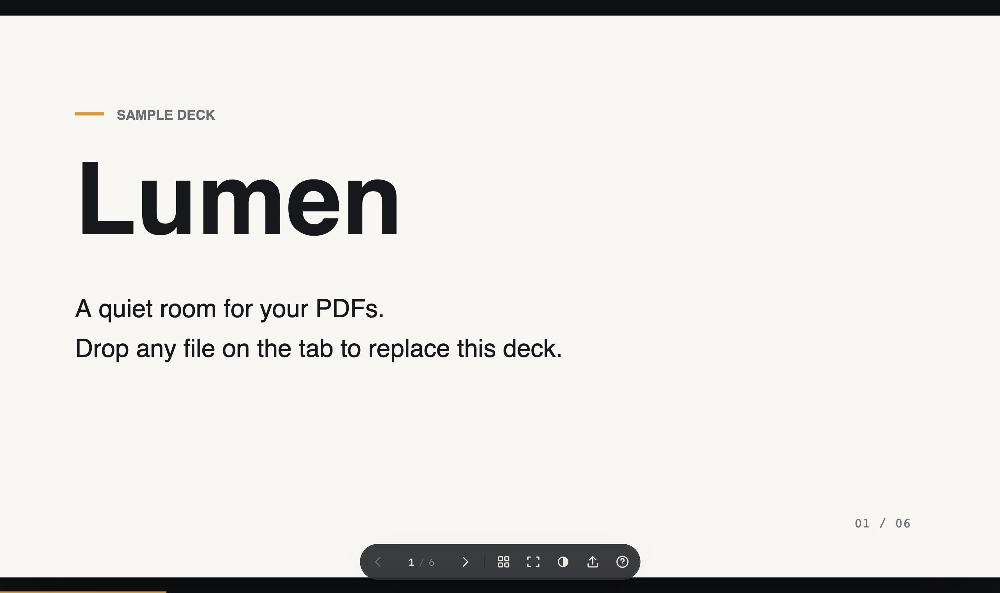
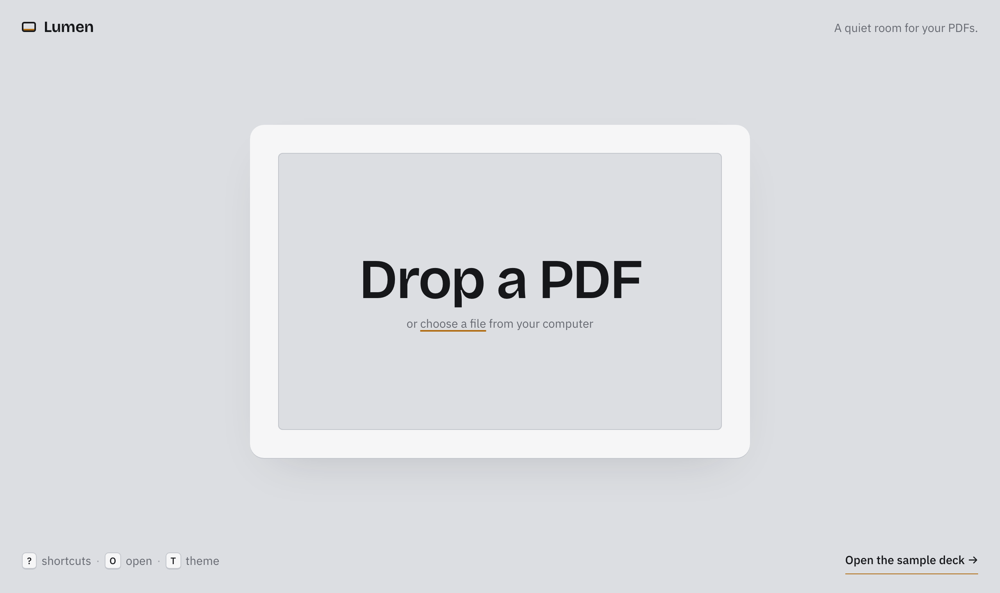
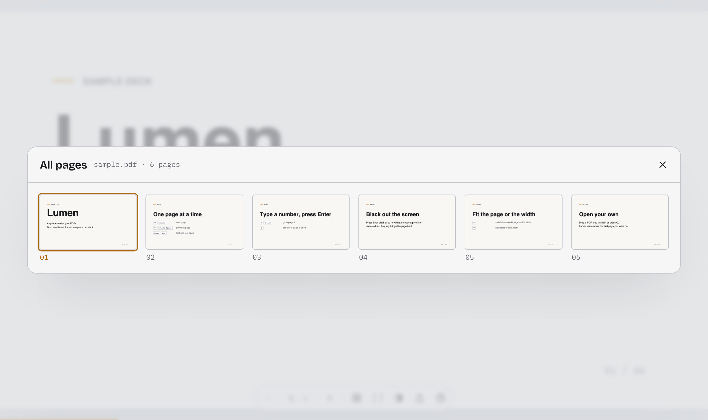

# Lumen

**A quiet room for your PDFs.** Lumen is a small browser viewer for presenting a PDF like a slide deck: one page, fitted to the tab, with controls that step out of the way.



## Why

Most PDF viewers are made for reading. Lumen is made for presenting. It shows one page fitted to the tab, keeps the controls in a small floating bar that hides when the mouse is idle, and gives you the keys a presenter expects: arrows, Space, a page number and Enter, and black or white screen.

"Full screen" in Lumen means filling the browser tab. It never uses the browser Fullscreen API and never takes over your monitor, so you can share just the tab in a video call and keep the rest of your screen for yourself.

## Features

- **Opening a PDF:** drop it anywhere on the tab, click the drop target, press <kbd>O</kbd>, or link to it with `?file=<url>`.
- **Sharp pages:** pages render at your screen's pixel density. When you resize, the page stays fitted right away and is re-rendered sharp a moment later.
- **Fast paging:** recent pages are cached, and the next and previous pages render ahead while the browser is idle.
- **Overview:** <kbd>G</kbd> shows a grid of every page; click one to jump to it.
- **Black or white screen:** <kbd>B</kbd> or <kbd>W</kbd> blanks the screen, like a projector remote does. Any key brings the page back.
- **Two themes:** *light table* and *dark room*. Lumen follows your system theme, and <kbd>T</kbd> switches it.
- **Pen and highlighter:** <kbd>P</kbd> or <kbd>H</kbd> to mark up a slide while you talk, <kbd>C</kbd> to change color, <kbd>Z</kbd> to undo. Marks stay on their page until you close the tab.
- **Working links:** links inside the PDF work. Links to another page jump there, and web links open in a new tab.
- **Page in the address:** the address ends in `#page=N`, so you can link to a slide. Back and Forward undo jumps.
- **Survives a reload:** a PDF you opened from disk is kept in this browser (up to 100 MB), so reloading the tab brings it back on the same page. In a new tab, Lumen offers to reopen it.
- **Remembers your place:** reopen a file and you're back on the page you left.
- **Touch support:** swipe to change pages; tap the center to show the controls.
- **Private:** your PDF is read in the browser and never uploaded anywhere.

| Empty state, light table | All pages |
| --- | --- |
|  |  |

## Keyboard shortcuts

| Keys | Action |
| --- | --- |
| <kbd>→</kbd> <kbd>Space</kbd> <kbd>PgDn</kbd> | Next page |
| <kbd>←</kbd> <kbd>Shift</kbd>+<kbd>Space</kbd> <kbd>PgUp</kbd> | Previous page |
| <kbd>Home</kbd> / <kbd>End</kbd> | First or last page |
| a number, then <kbd>Enter</kbd> | Go to that page (`12` <kbd>Enter</kbd> → page 12) |
| <kbd>G</kbd> | All pages |
| <kbd>F</kbd> | Fit page or fit width |
| <kbd>B</kbd> or <kbd>.</kbd> | Black screen |
| <kbd>W</kbd> or <kbd>,</kbd> | White screen |
| <kbd>T</kbd> | Light table or dark room |
| <kbd>O</kbd> | Open another PDF |
| <kbd>?</kbd> | Show the shortcuts |
| <kbd>P</kbd> | Pen on or off |
| <kbd>H</kbd> | Highlighter on or off |
| <kbd>C</kbd> | Next pen color (red, amber, blue, green, black) |
| <kbd>Z</kbd> or <kbd>⌘Z</kbd> / <kbd>Ctrl</kbd>+<kbd>Z</kbd> | Undo the last mark |
| <kbd>E</kbd> | Erase all marks on this page |
| <kbd>Esc</kbd> | Put the pen down |

With the mouse, click the left 35% of a page to go back and anywhere else to go forward. While the pen is in hand, clicks draw instead, and the arrow keys still change pages.

## Getting started

You need [Node.js](https://nodejs.org/) 22.12 or newer and [pnpm](https://pnpm.io/). This project uses pnpm only, so please don't use npm or yarn.

```sh
git clone https://github.com/SrChezz/lumen.git
cd lumen
pnpm install
pnpm dev
```

Then open <http://localhost:4321> and click **Open the sample deck**, or drop in your own PDF.

`pnpm dev` first runs `scripts/prepare-assets.mjs`, which copies pdf.js's font data (`cmaps`, `standard_fonts`) into `public/pdfjs/` and generates the sample deck at `public/sample.pdf` if it's missing. Astro 7 runs the dev server in the background: use `pnpm exec astro dev status` to check on it and `pnpm exec astro dev stop` to stop it.

### Scripts

| Command | What it does |
| --- | --- |
| `pnpm dev` | Prepares the assets and serves the site at http://localhost:4321 |
| `pnpm build` | Builds the static site into `dist/` |
| `pnpm preview` | Serves the built `dist/` locally |
| `pnpm exec tsc --noEmit -p .` | Type checks the project |

### Opening a PDF from a URL

Add `?file=` to the address to open a PDF when the page loads:

```
http://localhost:4321/?file=/sample.pdf
```

Add `#page=N` to start on a given page: `?file=/sample.pdf#page=3`.

The PDF has to be on the same origin, or on a server that sends CORS headers that allow it, because the browser fetches it directly.

## Deploying

`pnpm build` writes a fully static site to `dist/`, with no server code. You can host that folder on any static host, such as GitHub Pages, Netlify, Cloudflare Pages or Vercel.

## How it's built

- **[Astro](https://astro.build/)** builds a single static page.
- **[pdf.js](https://mozilla.github.io/pdf.js/)** (`pdfjs-dist`) renders the pages. Its worker loads as a separate asset.
- **[pdf-lib](https://pdf-lib.js.org/)** generates the sample deck when you build.
- Fonts are **Bricolage Grotesque** (display), **IBM Plex Sans** (interface) and **IBM Plex Mono** (numbers), served locally through Fontsource.

```
src/
  pages/index.astro     markup: empty state, stage, floating controls, dialogs
  styles/lumen.css      design tokens and both themes
  scripts/viewer.ts     loading, rendering, cache, links, address, keys, touch
  scripts/ink.ts        the pen and highlighter layer
  scripts/saved-file.ts keeps the last local PDF in IndexedDB
scripts/
  prepare-assets.mjs    copies pdf.js font data and builds the sample deck
public/
  sample.pdf            the sample deck
  favicon.svg
```

Each page renders to a canvas at `devicePixelRatio`, inside a "sheet" that CSS sizes to the page's shape with container query units, so it fills the tab instantly while the sharp re-render waits until you stop resizing. The sheet also holds the link layer and the ink canvas. Ink points are stored as fractions of the page, so marks stay in place when the page is resized or the fit mode changes. Up to eight rendered pages stay in a small LRU cache.

The design uses one accent color, `--lamp`, an amber like a projector lamp, and uses it sparingly: for focus rings, the progress bar, the current page in the overview and drop targets.

## Privacy

Lumen has no backend, analytics or tracking. A PDF you open is read in your browser. Lumen stores, all in your browser:

- a few preferences in `localStorage`: theme, fit mode and the last page of each file;
- the last PDF you opened from disk, in IndexedDB, so a reload can bring it back. **Forget it** on the start screen deletes it;
- your pen marks, in `sessionStorage`, which the browser clears when you close the tab.

If storage is blocked, Lumen still works and just doesn't remember them.

## License

[MIT](LICENSE) © 2026 Cesar Atachao
